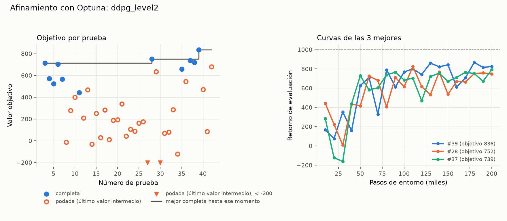

# Afinamiento: ddpg_level2

Generado el 2026-11-07 19:21 con `python -m analysis.resumen_afinamiento`. Fuente: el estudio de Optuna (`.db`) y las corridas de cada prueba (no se versionan).

## Protocolo

- Nivel 2, 200000 pasos por prueba, semillas [0].
- Objetivo: media de las últimas 3 evaluaciones (§6).
- Muestreador TPE (5 pruebas al azar al inicio); podador median (sin poda en las primeras 5 completas ni antes de 50000 pasos). Según `tune.yaml` al generar este resumen.
- Código: commit 066423c. Máquina: LAPTOP-V9KBFJLE.
- Versiones: python 3.12.10, mujoco 3.17.0, gymnasium 1.4.0, stable-baselines3 2.9.2, torch 2.15.0+cpu, numpy 2.5.4, pyyaml 6.0.3.

## Resultado

- **40 pruebas válidas**: 11 completas, 29 podadas, 0 fallidas (divergencia). Además, 3 interrumpidas (corte del proceso; no cuentan).
- Duración: 2026-11-07 00:21 a 08:00 (7.6 h de reloj, 25.8 h de CPU sumando procesos). 4.28 M pasos de entorno en total.

### Mejor prueba: #39 (objetivo 836.3)

Evaluación final 825.5, mejor evaluación 868.3, 61.7 pasos/s.

| Hiperparámetro | Rango de búsqueda | En el YAML al generar | Mejor prueba | ¿Cerca del borde? |
|---|---|---|---|---|
| `learning_rate` | 1e-05 – 0.003 (log) | 0.001 | 0.000885 |  |
| `action_noise.sigma` | 0.02 – 0.5 (log) | 0.1 | 0.236 |  |
| `tau` | 0.001 – 0.05 (log) | 0.005 | 0.0171 |  |
| `batch_size` | [64, 128, 256, 512] | 256 | 256 |  |

### Las 5 mejores

| # | Objetivo | Eval. final | Mejor eval. | Min | `learning_rate` | `action_noise.sigma` | `tau` | `batch_size` |
|---|---|---|---|---|---|---|---|---|
| 39 | 836.3 | 825.5 | 868.3 | 54.1 | 0.000885 | 0.236 | 0.0171 | 256 |
| 28 | 752.2 | 747.0 | 823.9 | 68.8 | 0.00145 | 0.186 | 0.0354 | 128 |
| 37 | 738.7 | 791.2 | 791.2 | 56.1 | 0.00274 | 0.224 | 0.0318 | 128 |
| 38 | 718.6 | 845.7 | 845.7 | 42.6 | 0.000729 | 0.344 | 0.0492 | 128 |
| 3 | 714.1 | 620.3 | 800.2 | 82.5 | 0.000231 | 0.195 | 0.00312 | 256 |

Cada prueba usa una sola semilla: diferencias pequeñas entre las mejores pueden ser ruido de la semilla.

## Todas las pruebas

Para las podadas, *objetivo* es el último valor intermedio (media de las últimas evaluaciones hasta ese paso).

| # | Estado | Objetivo | Pasos | Min | `learning_rate` | `action_noise.sigma` | `tau` | `batch_size` |
|---|---|---|---|---|---|---|---|---|
| 0 | interrumpida | – | – | 3.86 | 0.000229 | 0.2 | 0.0106 | 256 |
| 1 | interrumpida | – | – | 3.77 | 0.000108 | 0.203 | 0.001 | 64 |
| 2 | interrumpida | – | – | 3.63 | 0.00012 | 0.0217 | 0.00859 | 64 |
| 3 | completa | 714.1 | 200000 | 82.5 | 0.000231 | 0.195 | 0.00312 | 256 |
| 4 | completa | 570.5 | 200000 | 126 | 0.00249 | 0.116 | 0.0449 | 512 |
| 5 | completa | 524.2 | 200000 | 54 | 3.55e-05 | 0.33 | 0.00224 | 64 |
| 6 | completa | 702.6 | 200000 | 90.1 | 0.00163 | 0.0582 | 0.0248 | 256 |
| 7 | completa | 566.5 | 200000 | 59.1 | 0.000192 | 0.052 | 0.00208 | 128 |
| 8 | podada | -13.1 | 120000 | 44.1 | 3.26e-05 | 0.0236 | 0.00561 | 256 |
| 9 | podada | 279.3 | 130000 | 37.2 | 0.000109 | 0.0589 | 0.0114 | 128 |
| 10 | podada | 400.7 | 100000 | 32.4 | 0.00151 | 0.0483 | 0.00506 | 128 |
| 11 | completa | 441.8 | 200000 | 86.1 | 0.00185 | 0.329 | 0.00158 | 256 |
| 12 | podada | 209.0 | 70000 | 27.2 | 0.00112 | 0.458 | 0.00989 | 256 |
| 13 | podada | 468.7 | 110000 | 42.6 | 0.000306 | 0.144 | 0.0386 | 256 |
| 14 | podada | -30.4 | 50000 | 18.4 | 1.11e-05 | 0.0301 | 0.00136 | 256 |
| 15 | podada | 252.0 | 70000 | 39.7 | 0.000336 | 0.187 | 0.00251 | 512 |
| 16 | podada | 28.4 | 60000 | 22.5 | 3.18e-05 | 0.131 | 0.0198 | 256 |
| 17 | podada | 283.8 | 80000 | 30.8 | 0.00038 | 0.0547 | 0.0197 | 256 |
| 18 | podada | 11.3 | 60000 | 23.1 | 0.00154 | 0.129 | 0.00431 | 256 |
| 19 | podada | 189.4 | 60000 | 22.6 | 0.000753 | 0.0261 | 0.00264 | 256 |
| 20 | podada | 194.8 | 60000 | 16.6 | 0.00297 | 0.0264 | 0.025 | 64 |
| 21 | podada | 339.0 | 70000 | 26.5 | 0.000322 | 0.119 | 0.00426 | 256 |
| 22 | podada | 43.3 | 50000 | 18.4 | 7.59e-05 | 0.108 | 0.00431 | 256 |
| 23 | podada | 105.7 | 60000 | 24.9 | 0.00244 | 0.156 | 0.0151 | 256 |
| 24 | podada | 87.3 | 50000 | 20.2 | 0.0013 | 0.0315 | 0.0302 | 256 |
| 25 | podada | 160.8 | 60000 | 22.3 | 0.000141 | 0.165 | 0.00122 | 256 |
| 26 | podada | 175.2 | 60000 | 18.3 | 0.000813 | 0.0974 | 0.00204 | 128 |
| 27 | podada | -494.8 | 50000 | 29.5 | 0.00211 | 0.115 | 0.0382 | 512 |
| 28 | completa | 752.2 | 200000 | 68.8 | 0.00145 | 0.186 | 0.0354 | 128 |
| 29 | podada | 633.7 | 110000 | 60.6 | 0.000473 | 0.104 | 0.0491 | 512 |
| 30 | podada | -1000.9 | 50000 | 20.4 | 0.00209 | 0.0713 | 0.0125 | 256 |
| 31 | podada | 70.3 | 60000 | 34.1 | 0.00103 | 0.0924 | 0.0163 | 512 |
| 32 | podada | 79.7 | 50000 | 19.4 | 0.00014 | 0.219 | 0.00534 | 256 |
| 33 | podada | 285.8 | 60000 | 19.5 | 0.000914 | 0.131 | 0.00847 | 256 |
| 34 | podada | -120.9 | 50000 | 12.8 | 0.00201 | 0.0736 | 0.0462 | 128 |
| 35 | completa | 658.9 | 200000 | 55.1 | 0.00104 | 0.322 | 0.0404 | 128 |
| 36 | podada | 544.4 | 90000 | 44.2 | 0.00253 | 0.238 | 0.0471 | 512 |
| 37 | completa | 738.7 | 200000 | 56.1 | 0.00274 | 0.224 | 0.0318 | 128 |
| 38 | completa | 718.6 | 200000 | 42.6 | 0.000729 | 0.344 | 0.0492 | 128 |
| 39 | completa | 836.3 | 200000 | 54.1 | 0.000885 | 0.236 | 0.0171 | 256 |
| 40 | podada | 471.4 | 70000 | 14.8 | 0.00184 | 0.2 | 0.0225 | 128 |
| 41 | podada | 85.8 | 60000 | 10.2 | 0.000154 | 0.353 | 0.0478 | 128 |
| 42 | podada | 679.2 | 110000 | 18.2 | 0.00122 | 0.152 | 0.0266 | 128 |
