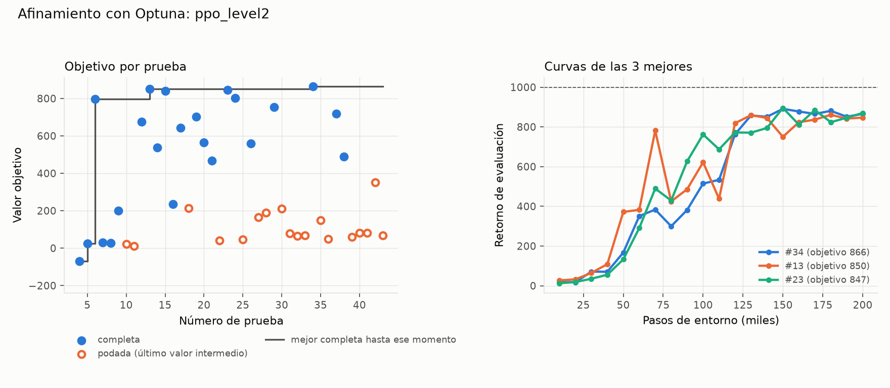

# Afinamiento: ppo_level2

Generado el 2026-11-07 22:31 con `python -m analysis.resumen_afinamiento`. Fuente: el estudio de Optuna (`.db`) y las corridas de cada prueba (no se versionan).

## Protocolo

- Nivel 2, 200000 pasos por prueba, semillas [0].
- Objetivo: media de las últimas 3 evaluaciones (§6).
- Muestreador TPE (5 pruebas al azar al inicio); podador median (sin poda en las primeras 5 completas ni antes de 50000 pasos). Según `tune.yaml` al generar este resumen.
- Código: commit 35c992e, 35c992e (con cambios sin commit), 4772700, c5a62a7, c5a62a7 (con cambios sin commit), c5f6b3d. Máquina: LAPTOP-V9KBFJLE.
- Versiones: python 3.12.10, mujoco 3.17.0, gymnasium 1.4.0, stable-baselines3 2.9.2, torch 2.15.0+cpu, numpy 2.5.4, pyyaml 6.0.3.

## Resultado

- **40 pruebas válidas**: 22 completas, 18 podadas, 0 fallidas (divergencia). Además, 4 interrumpidas (corte del proceso; no cuentan).
- Duración: 2026-11-07 19:55 a 22:28 (2.6 h de reloj, 9.2 h de CPU sumando procesos). 5.49 M pasos de entorno en total.

### Mejor prueba: #34 (objetivo 865.9)

Evaluación final 865.4, mejor evaluación 891.0, 235 pasos/s.

| Hiperparámetro | Rango de búsqueda | En el YAML al generar | Mejor prueba | ¿Cerca del borde? |
|---|---|---|---|---|
| `learning_rate` | 1e-05 – 0.001 (log) | 0.0003 | 0.000161 |  |
| `clip_range` | 0.1 – 0.4 | 0.2 | 0.163 |  |
| `n_epochs` | 3 – 20 | 10 | 16 |  |
| `n_steps` | [512, 1024, 2048, 4096] | 2048 | 2048 |  |
| `gae_lambda` | 0.8 – 0.99 | 0.95 | 0.95 |  |

### Las 5 mejores

| # | Objetivo | Eval. final | Mejor eval. | Min | `learning_rate` | `clip_range` | `n_epochs` | `n_steps` | `gae_lambda` |
|---|---|---|---|---|---|---|---|---|---|
| 34 | 865.9 | 865.4 | 891.0 | 14.3 | 0.000161 | 0.163 | 16 | 2048 | 0.95 |
| 13 | 849.8 | 846.7 | 860.6 | 28.7 | 0.00038 | 0.264 | 15 | 2048 | 0.919 |
| 23 | 846.7 | 870.1 | 895.8 | 16.1 | 0.000183 | 0.152 | 16 | 2048 | 0.926 |
| 15 | 840.8 | 854.5 | 864.5 | 19.9 | 0.000205 | 0.167 | 6 | 2048 | 0.92 |
| 24 | 801.8 | 662.3 | 893.4 | 14.3 | 0.00026 | 0.211 | 12 | 2048 | 0.874 |

Cada prueba usa una sola semilla: diferencias pequeñas entre las mejores pueden ser ruido de la semilla.

## Todas las pruebas

Para las podadas, *objetivo* es el último valor intermedio (media de las últimas evaluaciones hasta ese paso).

| # | Estado | Objetivo | Pasos | Min | `learning_rate` | `clip_range` | `n_epochs` | `n_steps` | `gae_lambda` |
|---|---|---|---|---|---|---|---|---|---|
| 0 | interrumpida | 43.8 | 10000 | 3.09 | 0.000125 | 0.315 | 13 | 2048 | 0.969 |
| 1 | interrumpida | -8.91 | 20000 | 3 | 6.82e-05 | 0.316 | 3 | 512 | 0.866 |
| 2 | interrumpida | 51 | 10000 | 2.89 | 7.45e-05 | 0.108 | 12 | 512 | 0.918 |
| 3 | interrumpida | 48.4 | 10000 | 2.77 | 0.000126 | 0.312 | 8 | 2048 | 0.839 |
| 4 | completa | -69.9 | 200000 | 43.5 | 0.000859 | 0.264 | 20 | 4096 | 0.801 |
| 5 | completa | 25.1 | 200000 | 25.5 | 2.78e-05 | 0.361 | 6 | 512 | 0.898 |
| 6 | completa | 798.3 | 200000 | 46.5 | 0.000611 | 0.2 | 17 | 2048 | 0.88 |
| 7 | completa | 29.5 | 200000 | 32 | 1.42e-05 | 0.334 | 10 | 1024 | 0.814 |
| 8 | completa | 26.5 | 200000 | 21.4 | 3.92e-05 | 0.156 | 4 | 4096 | 0.852 |
| 9 | completa | 200.5 | 200000 | 27 | 3.44e-05 | 0.25 | 15 | 512 | 0.973 |
| 10 | podada | 20.9 | 50000 | 5.89 | 3.21e-05 | 0.23 | 17 | 2048 | 0.913 |
| 11 | podada | 10.8 | 50000 | 3.96 | 4.69e-05 | 0.287 | 10 | 512 | 0.988 |
| 12 | completa | 676.5 | 200000 | 30.3 | 0.00038 | 0.154 | 19 | 2048 | 0.881 |
| 13 | completa | 849.8 | 200000 | 28.7 | 0.00038 | 0.264 | 15 | 2048 | 0.919 |
| 14 | completa | 538.4 | 200000 | 25.5 | 0.000501 | 0.154 | 12 | 2048 | 0.83 |
| 15 | completa | 840.8 | 200000 | 19.9 | 0.000205 | 0.167 | 6 | 2048 | 0.92 |
| 16 | completa | 235.6 | 200000 | 19.3 | 0.000331 | 0.376 | 17 | 2048 | 0.853 |
| 17 | completa | 643.7 | 200000 | 18.7 | 0.000316 | 0.272 | 15 | 2048 | 0.832 |
| 18 | podada | 213.2 | 140000 | 13.1 | 0.000188 | 0.254 | 18 | 2048 | 0.924 |
| 19 | completa | 703.1 | 200000 | 13.5 | 0.000212 | 0.217 | 7 | 2048 | 0.937 |
| 20 | completa | 565.8 | 200000 | 12.9 | 0.000803 | 0.151 | 9 | 2048 | 0.902 |
| 21 | completa | 468.6 | 200000 | 11.8 | 0.000468 | 0.313 | 8 | 2048 | 0.868 |
| 22 | podada | 41.7 | 50000 | 2.48 | 6.68e-05 | 0.15 | 8 | 2048 | 0.882 |
| 23 | completa | 846.7 | 200000 | 16.1 | 0.000183 | 0.152 | 16 | 2048 | 0.926 |
| 24 | completa | 801.8 | 200000 | 14.3 | 0.00026 | 0.211 | 12 | 2048 | 0.874 |
| 25 | podada | 47.3 | 50000 | 1.95 | 0.000407 | 0.104 | 4 | 2048 | 0.932 |
| 26 | completa | 559.1 | 200000 | 11 | 0.000623 | 0.195 | 5 | 2048 | 0.896 |
| 27 | podada | 165.6 | 70000 | 3.68 | 0.000485 | 0.164 | 9 | 2048 | 0.95 |
| 28 | podada | 188.7 | 70000 | 5.63 | 0.000912 | 0.232 | 20 | 2048 | 0.945 |
| 29 | completa | 752.7 | 200000 | 15.5 | 0.000339 | 0.169 | 16 | 2048 | 0.941 |
| 30 | podada | 212.4 | 70000 | 5.65 | 0.000424 | 0.104 | 20 | 2048 | 0.941 |
| 31 | podada | 77.8 | 50000 | 3.88 | 9.84e-05 | 0.16 | 20 | 2048 | 0.926 |
| 32 | podada | 65.9 | 50000 | 3.22 | 0.000135 | 0.218 | 14 | 2048 | 0.919 |
| 33 | podada | 69.1 | 50000 | 2.76 | 0.000231 | 0.145 | 10 | 2048 | 0.922 |
| 34 | completa | 865.9 | 200000 | 14.3 | 0.000161 | 0.163 | 16 | 2048 | 0.95 |
| 35 | podada | 147.7 | 60000 | 3.25 | 0.000199 | 0.171 | 9 | 2048 | 0.957 |
| 36 | podada | 49.8 | 50000 | 3.4 | 0.000107 | 0.103 | 18 | 2048 | 0.903 |
| 37 | completa | 719.7 | 200000 | 14.9 | 0.00027 | 0.234 | 18 | 2048 | 0.953 |
| 38 | completa | 488.4 | 200000 | 11.8 | 0.000359 | 0.275 | 12 | 2048 | 0.929 |
| 39 | podada | 59.9 | 50000 | 2.84 | 0.00012 | 0.157 | 14 | 2048 | 0.967 |
| 40 | podada | 81.9 | 50000 | 3.12 | 0.000244 | 0.189 | 18 | 2048 | 0.986 |
| 41 | podada | 81.3 | 50000 | 2.19 | 0.000405 | 0.119 | 14 | 2048 | 0.923 |
| 42 | podada | 351.9 | 80000 | 4.94 | 0.0002 | 0.15 | 16 | 2048 | 0.935 |
| 43 | podada | 69.3 | 50000 | 3.78 | 9.94e-05 | 0.153 | 17 | 2048 | 0.925 |
