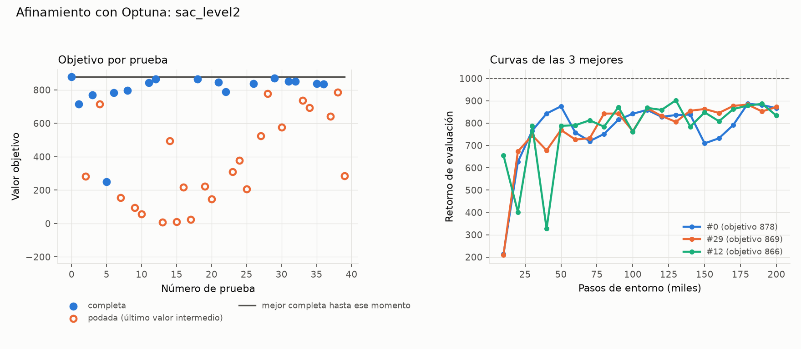

# Afinamiento: sac_level2

Generado el 2026-11-09 05:52 con `python -m analysis.resumen_afinamiento`. Fuente: el estudio de Optuna (`.db`) y las corridas de cada prueba (no se versionan).

## Protocolo

- Nivel 2, 200000 pasos por prueba, semillas [0].
- Objetivo: media de las últimas 3 evaluaciones (§6).
- Muestreador TPE (5 pruebas al azar al inicio); podador median (sin poda en las primeras 5 completas ni antes de 50000 pasos). Según `tune.yaml` al generar este resumen.
- Código: commit 9576d09 (con cambios sin commit). Máquina: WH-Chris.
- Versiones: python 3.12.13, mujoco 3.17.0, gymnasium 1.4.0, stable-baselines3 2.9.2, torch 2.15.0+cpu, numpy 2.5.4, pyyaml 6.0.3.

## Resultado

- **40 pruebas válidas**: 17 completas, 23 podadas, 0 fallidas (divergencia).
- Duración: 2026-11-09 01:18 a 05:19 (4.0 h de reloj, 22.5 h de CPU sumando procesos). 5.20 M pasos de entorno en total.

### Mejor prueba: #0 (objetivo 878.1)

Evaluación final 866.7, mejor evaluación 886.5, 66.3 pasos/s.

| Hiperparámetro | Rango de búsqueda | En el YAML al generar | Mejor prueba | ¿Cerca del borde? |
|---|---|---|---|---|
| `learning_rate` | 1e-05 – 0.003 (log) | 0.000229 | 0.000229 |  |
| `ent_coef` | ['auto', 0.001, 0.01, 0.05, 0.1] | auto | auto | bajo |
| `tau` | 0.001 – 0.05 (log) | 0.00554 | 0.00554 |  |
| `batch_size` | [64, 128, 256, 512] | 128 | 128 |  |

### Las 5 mejores

| # | Objetivo | Eval. final | Mejor eval. | Min | `learning_rate` | `ent_coef` | `tau` | `batch_size` |
|---|---|---|---|---|---|---|---|---|
| 0 | 878.1 | 866.7 | 886.5 | 50.3 | 0.000229 | auto | 0.00554 | 128 |
| 29 | 869.0 | 872.0 | 882.8 | 40.2 | 0.00271 | auto | 0.00684 | 128 |
| 12 | 866.1 | 833.5 | 902.0 | 49.8 | 0.00118 | auto | 0.0133 | 128 |
| 18 | 864.6 | 879.3 | 879.3 | 37.7 | 0.000965 | 0.01 | 0.00793 | 64 |
| 31 | 851.8 | 814.0 | 872.4 | 31.1 | 0.00111 | auto | 0.0176 | 64 |

Cada prueba usa una sola semilla: diferencias pequeñas entre las mejores pueden ser ruido de la semilla.

## Todas las pruebas

Para las podadas, *objetivo* es el último valor intermedio (media de las últimas evaluaciones hasta ese paso).

| # | Estado | Objetivo | Pasos | Min | `learning_rate` | `ent_coef` | `tau` | `batch_size` |
|---|---|---|---|---|---|---|---|---|
| 0 | completa | 878.1 | 200000 | 50.3 | 0.000229 | auto | 0.00554 | 128 |
| 1 | completa | 714.0 | 200000 | 70.2 | 0.000108 | auto | 0.00207 | 256 |
| 2 | podada | 283.3 | 130000 | 75.9 | 0.00012 | 0.001 | 0.00223 | 512 |
| 3 | completa | 769.2 | 200000 | 69.7 | 0.000231 | 0.1 | 0.00163 | 256 |
| 4 | podada | 714.1 | 130000 | 76.9 | 0.00249 | 0.001 | 0.0456 | 512 |
| 5 | completa | 250.8 | 200000 | 38.4 | 3.55e-05 | 0.01 | 0.02 | 64 |
| 6 | completa | 783.7 | 200000 | 74.4 | 0.00163 | 0.001 | 0.00795 | 256 |
| 7 | podada | 153.4 | 130000 | 75.8 | 1.55e-05 | 0.05 | 0.0071 | 512 |
| 8 | completa | 795.8 | 200000 | 40.6 | 0.000675 | 0.01 | 0.00318 | 64 |
| 9 | podada | 93.9 | 80000 | 27.2 | 0.000204 | 0.001 | 0.026 | 256 |
| 10 | podada | 56.9 | 50000 | 28.4 | 0.000135 | 0.01 | 0.0089 | 512 |
| 11 | completa | 843.2 | 200000 | 93.4 | 0.000498 | 0.001 | 0.0089 | 512 |
| 12 | completa | 866.1 | 200000 | 49.8 | 0.00118 | auto | 0.0133 | 128 |
| 13 | podada | 8.99 | 50000 | 11.7 | 1.23e-05 | auto | 0.00759 | 128 |
| 14 | podada | 494.8 | 70000 | 16.9 | 6.83e-05 | auto | 0.00509 | 128 |
| 15 | podada | 9.66 | 50000 | 11.1 | 1.46e-05 | 0.1 | 0.0447 | 128 |
| 16 | podada | 218.2 | 50000 | 11.4 | 0.00195 | 0.001 | 0.00329 | 128 |
| 17 | podada | 23.9 | 50000 | 17.1 | 1.11e-05 | auto | 0.00144 | 256 |
| 18 | completa | 864.6 | 200000 | 37.7 | 0.000965 | 0.01 | 0.00793 | 64 |
| 19 | podada | 221.6 | 50000 | 9.07 | 0.00163 | 0.01 | 0.00353 | 64 |
| 20 | podada | 146.8 | 50000 | 8.96 | 0.000278 | 0.01 | 0.00181 | 64 |
| 21 | completa | 844.6 | 200000 | 36.8 | 0.00053 | auto | 0.00504 | 64 |
| 22 | completa | 789.9 | 200000 | 42.7 | 0.000301 | auto | 0.001 | 128 |
| 23 | podada | 309.5 | 50000 | 8.63 | 0.000412 | 0.01 | 0.00314 | 64 |
| 24 | podada | 377.5 | 50000 | 8.61 | 6.35e-05 | 0.1 | 0.00383 | 64 |
| 25 | podada | 205.3 | 50000 | 8.42 | 0.00152 | 0.01 | 0.00177 | 64 |
| 26 | completa | 837.1 | 200000 | 36.4 | 0.00251 | 0.01 | 0.0126 | 64 |
| 27 | podada | 524.7 | 70000 | 20.4 | 0.00101 | 0.001 | 0.00734 | 256 |
| 28 | podada | 778.4 | 150000 | 28 | 0.000215 | auto | 0.0348 | 128 |
| 29 | completa | 869.0 | 200000 | 40.2 | 0.00271 | auto | 0.00684 | 128 |
| 30 | podada | 577.5 | 60000 | 11.2 | 0.00131 | 0.1 | 0.0263 | 128 |
| 31 | completa | 851.8 | 200000 | 31.1 | 0.00111 | auto | 0.0176 | 64 |
| 32 | completa | 851.6 | 200000 | 31.7 | 0.000762 | auto | 0.017 | 128 |
| 33 | podada | 737.7 | 120000 | 14.3 | 0.000827 | 0.01 | 0.0091 | 64 |
| 34 | podada | 692.7 | 90000 | 11.4 | 0.000412 | 0.01 | 0.0118 | 128 |
| 35 | completa | 836.6 | 200000 | 35.1 | 0.00153 | auto | 0.0104 | 128 |
| 36 | completa | 835.2 | 200000 | 37.7 | 0.00188 | auto | 0.00553 | 128 |
| 37 | podada | 642.2 | 90000 | 8.32 | 0.000255 | auto | 0.0138 | 64 |
| 38 | podada | 786.9 | 130000 | 33.6 | 0.00237 | 0.05 | 0.00911 | 128 |
| 39 | podada | 286.3 | 50000 | 8.89 | 0.00134 | 0.01 | 0.00612 | 64 |
