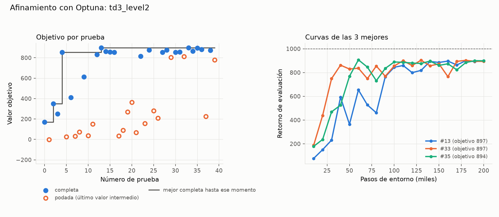

# Afinamiento: td3_level2

Generado el 2026-11-09 05:50 con `python -m analysis.resumen_afinamiento`. Fuente: el estudio de Optuna (`.db`) y las corridas de cada prueba (no se versionan).

## Protocolo

- Nivel 2, 200000 pasos por prueba, semillas [0].
- Objetivo: media de las últimas 3 evaluaciones (§6).
- Muestreador TPE (5 pruebas al azar al inicio); podador median (sin poda en las primeras 5 completas ni antes de 50000 pasos). Según `tune.yaml` al generar este resumen.
- Código: commit 9576d09 (con cambios sin commit). Máquina: WH-Chris.
- Versiones: python 3.12.13, mujoco 3.17.0, gymnasium 1.4.0, stable-baselines3 2.9.2, torch 2.15.0+cpu, numpy 2.5.4, pyyaml 6.0.3.

## Resultado

- **40 pruebas válidas**: 22 completas, 18 podadas, 0 fallidas (divergencia).
- Duración: 2026-11-09 01:18 a 04:19 (3.0 h de reloj, 20.5 h de CPU sumando procesos). 6.17 M pasos de entorno en total.

### Mejor prueba: #13 (objetivo 896.9)

Evaluación final 899.5, mejor evaluación 899.5, 78.2 pasos/s.

| Hiperparámetro | Rango de búsqueda | En el YAML al generar | Mejor prueba | ¿Cerca del borde? |
|---|---|---|---|---|
| `learning_rate` | 1e-05 – 0.003 (log) | 0.00195 | 0.00195 |  |
| `target_policy_noise` | 0.05 – 0.5 | 0.448 | 0.448 |  |
| `policy_delay` | 1 – 4 | 4 | 4 | alto |
| `action_noise.sigma` | 0.02 – 0.5 (log) | 0.478 | 0.478 | alto |

### Las 5 mejores

| # | Objetivo | Eval. final | Mejor eval. | Min | `learning_rate` | `target_policy_noise` | `policy_delay` | `action_noise.sigma` |
|---|---|---|---|---|---|---|---|---|
| 13 | 896.9 | 899.5 | 899.5 | 42.6 | 0.00195 | 0.448 | 4 | 0.478 |
| 33 | 896.9 | 893.5 | 903.8 | 31.7 | 0.0029 | 0.449 | 3 | 0.489 |
| 35 | 894.2 | 899.0 | 906.9 | 29.3 | 0.00256 | 0.464 | 4 | 0.445 |
| 36 | 881.0 | 922.4 | 922.4 | 28.3 | 0.00144 | 0.471 | 3 | 0.349 |
| 24 | 876.9 | 859.6 | 885.7 | 40.5 | 0.00265 | 0.439 | 3 | 0.248 |

Cada prueba usa una sola semilla: diferencias pequeñas entre las mejores pueden ser ruido de la semilla.

## Todas las pruebas

Para las podadas, *objetivo* es el último valor intermedio (media de las últimas evaluaciones hasta ese paso).

| # | Estado | Objetivo | Pasos | Min | `learning_rate` | `target_policy_noise` | `policy_delay` | `action_noise.sigma` |
|---|---|---|---|---|---|---|---|---|
| 0 | completa | 170.6 | 200000 | 41.5 | 0.000229 | 0.372 | 3 | 0.116 |
| 1 | podada | -1.6 | 170000 | 46.1 | 0.000108 | 0.374 | 1 | 0.0529 |
| 2 | completa | 350.2 | 200000 | 41.1 | 0.00012 | 0.0617 | 3 | 0.0812 |
| 3 | completa | 250.9 | 200000 | 44.7 | 0.000231 | 0.369 | 2 | 0.104 |
| 4 | completa | 854.1 | 200000 | 44.8 | 0.00249 | 0.296 | 4 | 0.2 |
| 5 | podada | 25.7 | 160000 | 44.8 | 3.55e-05 | 0.442 | 1 | 0.385 |
| 6 | completa | 411.8 | 200000 | 42.8 | 0.00163 | 0.199 | 4 | 0.0229 |
| 7 | podada | 30.5 | 200000 | 45.7 | 1.55e-05 | 0.401 | 2 | 0.205 |
| 8 | podada | 72.6 | 50000 | 13.7 | 0.00011 | 0.199 | 1 | 0.147 |
| 9 | completa | 611.9 | 200000 | 45.4 | 0.000112 | 0.341 | 2 | 0.353 |
| 10 | podada | 36 | 50000 | 10 | 1.85e-05 | 0.318 | 3 | 0.077 |
| 11 | podada | 149.5 | 60000 | 16.4 | 0.00163 | 0.453 | 1 | 0.039 |
| 12 | completa | 830.5 | 200000 | 42.6 | 0.00152 | 0.12 | 4 | 0.166 |
| 13 | completa | 896.9 | 200000 | 42.6 | 0.00195 | 0.448 | 4 | 0.478 |
| 14 | completa | 863.4 | 200000 | 48.7 | 0.00187 | 0.366 | 2 | 0.379 |
| 15 | completa | 856.8 | 200000 | 40.5 | 0.00051 | 0.389 | 4 | 0.29 |
| 16 | completa | 853.1 | 200000 | 42.7 | 0.000659 | 0.274 | 3 | 0.482 |
| 17 | podada | 33.2 | 50000 | 11 | 0.000303 | 0.208 | 2 | 0.128 |
| 18 | podada | 88.9 | 50000 | 9.61 | 0.00141 | 0.209 | 4 | 0.025 |
| 19 | podada | 270.8 | 110000 | 21.9 | 0.00102 | 0.355 | 4 | 0.0864 |
| 20 | podada | 362.3 | 100000 | 19.5 | 0.000582 | 0.283 | 4 | 0.225 |
| 21 | podada | 66.7 | 50000 | 10 | 4.13e-05 | 0.349 | 3 | 0.295 |
| 22 | completa | 815.1 | 200000 | 36.2 | 0.000257 | 0.446 | 4 | 0.438 |
| 23 | podada | 155.5 | 50000 | 9.76 | 0.000391 | 0.455 | 3 | 0.27 |
| 24 | completa | 876.9 | 200000 | 40.5 | 0.00265 | 0.439 | 3 | 0.248 |
| 25 | podada | 281.2 | 50000 | 9.69 | 0.00111 | 0.454 | 4 | 0.296 |
| 26 | podada | 208.6 | 50000 | 9.92 | 0.00104 | 0.487 | 3 | 0.182 |
| 27 | completa | 854.0 | 200000 | 36.6 | 0.00143 | 0.366 | 4 | 0.311 |
| 28 | completa | 874.7 | 200000 | 37.7 | 0.00255 | 0.45 | 4 | 0.473 |
| 29 | podada | 803.9 | 190000 | 47.9 | 0.00134 | 0.409 | 1 | 0.311 |
| 30 | completa | 853.6 | 200000 | 34.6 | 0.000777 | 0.419 | 4 | 0.475 |
| 31 | completa | 855.5 | 200000 | 42.1 | 0.00217 | 0.351 | 2 | 0.454 |
| 32 | podada | 811.4 | 200000 | 36.2 | 0.00268 | 0.392 | 2 | 0.23 |
| 33 | completa | 896.9 | 200000 | 31.7 | 0.0029 | 0.449 | 3 | 0.489 |
| 34 | completa | 864.6 | 200000 | 30.5 | 0.00181 | 0.378 | 3 | 0.457 |
| 35 | completa | 894.2 | 200000 | 29.3 | 0.00256 | 0.464 | 4 | 0.445 |
| 36 | completa | 881.0 | 200000 | 28.3 | 0.00144 | 0.471 | 3 | 0.349 |
| 37 | podada | 225.3 | 50000 | 6.67 | 0.00236 | 0.405 | 4 | 0.178 |
| 38 | completa | 872.7 | 200000 | 22.3 | 0.00229 | 0.43 | 4 | 0.298 |
| 39 | podada | 778.4 | 130000 | 14.5 | 0.00238 | 0.496 | 3 | 0.257 |
