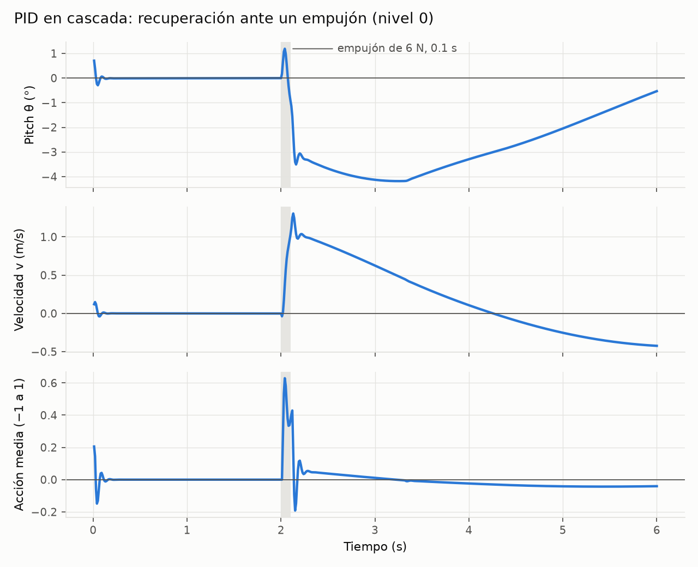
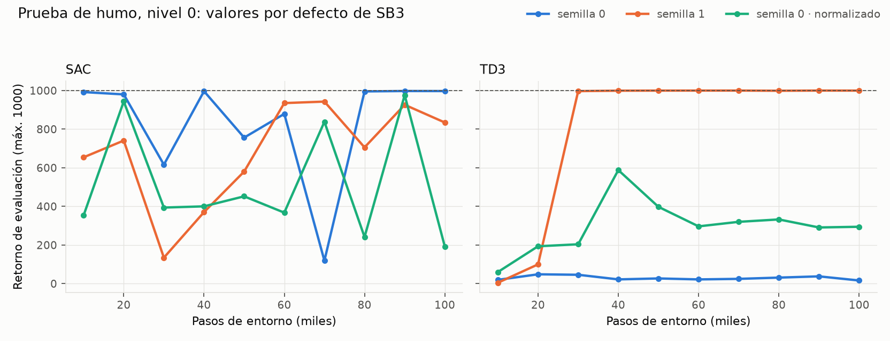

# Avance del proyecto — 2 de noviembre de 2026

**Proyecto:** robot de auto-balanceo de dos ruedas con aprendizaje por refuerzo profundo (CC3104).
**Equipo:** Christian Echeverría (entorno, pipeline, TD3 y SAC) · Mario Betancourt (DDPG y PPO).
**Repositorio:** <https://github.com/Ctribsz/ProyectoFinal-APR>
**Pregunta:** ¿qué algoritmo (DDPG, TD3, SAC o PPO) balancea mejor ante perturbaciones, y qué mecanismo técnico lo explica?

Las figuras se regeneran con `python -m analysis.avance_figures pid|smoke` (PNG en `docs/img/`; tablas y videos en `results/avance/`).

---

## 1. Estado general

| Fase | Contenido | Estado |
|---|---|---|
| F1 | Entorno MuJoCo y controlador PID | **Completa** |
| F2 | Pipeline de entrenamiento, niveles 1–3, prueba de humo | **En curso**: pipeline y niveles listos; prueba de humo de TD3/SAC corriendo; DDPG/PPO a cargo de Mario |
| F3 | Afinamiento con Optuna (40 pruebas por algoritmo) | Pendiente (7–8 nov) |
| F4 | Corridas finales con 10 semillas | Pendiente (9–10 nov) |
| F5 | Análisis e informe | Pendiente (11–13 nov) |

Entregables: E1, E2, E3, E4, E6 y E8 listos; E7 en curso; E5 pendiente (Mario). Detalle en `docs/entregables.md`.

## 2. Lo construido

### Modelo físico (`assets/balance_bot.xml`)
- Chasis de 1.0 kg y 0.30 m de alto, ruedas de 4 cm de radio separadas 18 cm, motores de 0.3 N·m.
- Sensores equivalentes a un robot real: IMU (orientación, giroscopio y acelerómetro) y encoders. Saturan en los rangos de hardware típico (giroscopio ±2000 °/s).
- Física a 500 Hz y control a 100 Hz.
- Convención de ejes verificada con pruebas: θ > 0 es inclinarse hacia adelante y el torque positivo hace avanzar al robot.

### Entorno (`envs/`)
- `BalanceBotEnv` de gymnasium, registrado como `BalanceBot-v0`. Pasa `check_env` sin advertencias.
- **Observación de 9 valores**, solo lo que mediría un robot real: pitch, velocidades angulares, velocidad de las ruedas, comandos y acción anterior.
- **Recompensa por componentes** (vivo, ángulo, velocidad angular, seguimiento de v y ψ̇, esfuerzo, suavidad). Cada término se registra por separado.
- **4 niveles de dificultad:**

| Nivel | Qué agrega |
|---|---|
| 0 | Balanceo en reposo |
| 1 | Empujones aleatorios (hasta 8 N durante 0.1 s, uno cada ~2 s, en la parte alta del chasis) |
| 2 | Comandos de velocidad (±0.5 m/s) y giro (±1 rad/s) que cambian cada 2–4 s |
| 3 | Ruido en sensores, latencia de 0–20 ms, masa ±20 %, fricción ±30 %, torque ±10 % |

- Render con cámara que sigue al robot y grabación a `.mp4`.

### Línea base: PID en cascada (`baselines/`)
- Lazo externo de velocidad → pitch objetivo → lazo interno de ángulo → torque, más un término diferencial para el giro.
- Usa solo la observación, igual que los agentes, y tiene la misma interfaz `predict(obs)` que una política de SB3.

### Pipeline de entrenamiento (`training/`)
- **Un solo `train.py` para los 4 algoritmos.** Solo cambia el YAML de cada algoritmo, lo que garantiza una comparación justa.
- Cada corrida guarda la semilla, la configuración completa, las versiones de las librerías, el commit de git, la máquina, la duración, las evaluaciones, el modelo y los logs de TensorBoard.

### Calidad
- **63 pruebas automáticas**: modelo físico, entorno, render, PID, niveles y pipeline. Incluyen determinismo por semilla, signos físicos, límites de la observación y la verificación de que la recompensa use lecturas limpias.

## 3. Resultados preliminares

### PID por nivel (20 episodios de 10 s cada uno)

| Nivel | Caídas | Retorno medio | RMSE v (m/s) | RMSE ψ̇ (rad/s) |
|---|---|---|---|---|
| 0 | 0/20 | 999.5 | 0.016 | — |
| 1 | 0/20 | 994.8 | 0.547 | — |
| 2 | 0/20 | 809.7 | 0.600 | 0.134 |
| 3 | **13/20** | −286.7 | 0.844 | 2.366 |

- El PID resuelve los niveles 0–2. **En el nivel 3 falla**: con ganancia alta en el ángulo, un ruido de 0.01 rad en θ se convierte en ±0.15 de acción, y la latencia lo desestabiliza. Es el escenario donde la hipótesis H4 espera que el RL lo supere.
- El PID tolera un empujón aislado de hasta **17.3 N**, medido por búsqueda binaria con un empujón a t = 2 s.

*El lazo de ángulo recupera la vertical en unos 0.2 s. El de velocidad es lento por diseño: se inclina −4° para frenar y tarda unos 2 s. Videos: `results/avance/pid_nivel{1,2,3}.mp4`.*

### Prueba de humo (nivel 0, valores por defecto de SB3, 100k pasos)

| Algoritmo | Semilla | Normalizado | Retorno final | Mejor retorno |
|---|---|---|---|---|
| SAC | 0 | no | 997 | 998 |
| SAC | 1 | no | 835 | 943 |
| SAC | 0 | sí | 192 | 976 |
| TD3 | 0 | no | 16 | 48 |
| TD3 | 1 | no | **1000** | 1000 |
| TD3 | 0 | sí | 295 | 588 |

- **El entorno se puede aprender.** SAC balancea los 10 s completos desde los 10k pasos. TD3 con la semilla 1 lo logra a los 30k pasos y no vuelve a fallar.
- **SAC aprende rápido pero es inestable**: entre evaluaciones oscila entre ~100 y 1000.
- **TD3 depende mucho de la semilla.** Con la semilla 0 nunca aprende en 100k pasos (retorno ~20–50); con la 1 queda perfecto. Por eso el protocolo exige 10 semillas y estadística robusta (IQM).
- **Normalizar las observaciones (D8)** no da una conclusión con una sola semilla. A TD3 semilla 0 lo ayuda (16 → 295) y a SAC lo empeora al final. Se repite con más semillas antes de decidir.
- **DDPG y PPO** están pendientes: Mario corre su prueba de humo sobre el mismo pipeline.

### Costo de cómputo medido

| Algoritmo | Pasos/s (1 proceso, CPU) | 1M pasos |
|---|---|---|
| SAC | 107 | ~2.6 h |
| TD3 | 171 | ~1.6 h |
| DDPG | 200 | ~1.4 h |
| PPO | 1946 | ~9 min |

Todo el protocolo (afinamiento y corridas finales) suma unas **160 h de CPU, unas 23 h de tiempo real** en un Ryzen 7 de 8 núcleos. Cabe en el cronograma.

## 4. Hallazgos de diseño

1. **El torque máximo de la especificación es muy alto para el tamaño del robot.** Con 0.3 N·m y ruedas de 4 cm, la aceleración posible (13.6 m/s²) supera a g, y a torque máximo el robot se despega del suelo. Esto puede llevar a los agentes a un control brusco, lo que mide la métrica de suavidad.
2. **El punto de aplicación del empujón importa.** Aplicado en el centro de masa, el robot solo rueda: el PID aguantaba 84 N y la prueba no medía el balanceo. Se aplica en la parte alta del chasis, en el plano sagital, porque un empujón lateral vuelca el robot sin que ningún controlador lo pueda evitar.
3. **El lazo de velocidad del PID debe ser lento.** Para frenar, el robot primero tiene que acelerar las ruedas (fase no mínima): con ganancia ≥ 0.2 se vuelve inestable.

## 5. Siguientes pasos

| Fecha | Qué |
|---|---|
| 3–5 nov | Prueba de humo de DDPG/PPO (Mario); decidir el presupuesto de pasos (D4) y la normalización (D8) |
| 6 nov | `tune.py` con Optuna y callbacks de diagnóstico: sobreestimación de Q, entropía, KL |
| 7–8 nov | Afinamiento de los 4 algoritmos en el nivel 2 |
| 8 nov | `evaluate.py` y `push_test.py` |
| 9–10 nov | 10 semillas por algoritmo; experimentos E1–E6 |
| 11–13 nov | Análisis estadístico con `rliable` (IQM, intervalos bootstrap), contraste de H1–H4, informe |
