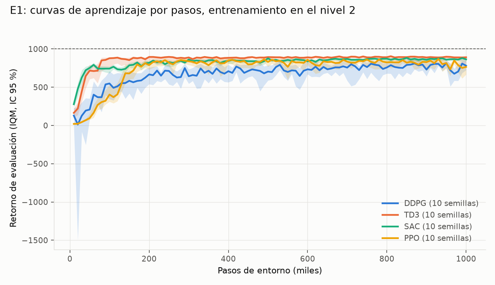
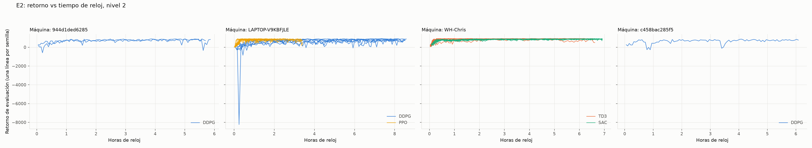
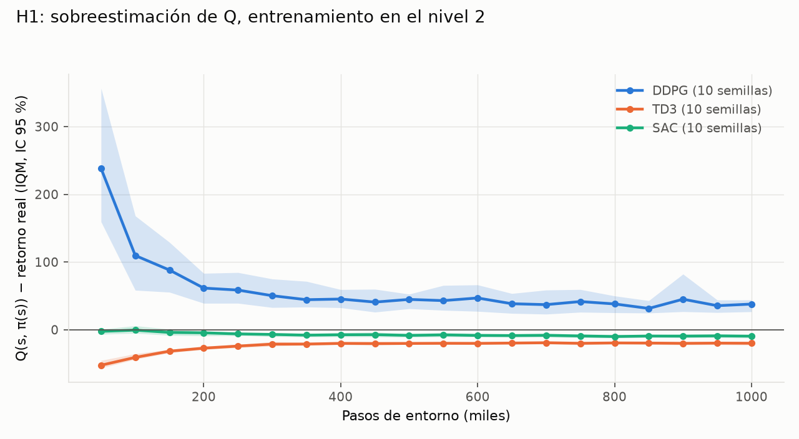

# Corridas finales: entrenamiento en el nivel 2

Generado con `python -m analysis.finales`. Retorno final de una corrida = media de sus últimas 3 evaluaciones. IQM (`rliable.metrics`) y media con IC 95 % por bootstrap percentil sobre corridas (2000 remuestreos, §7.5).

## Corridas

| Algoritmo | Semillas | Máquinas | Pasos por corrida | Pasos/s (mediana) | Commit |
|---|---|---|---|---|---|
| DDPG | 10: [0, 1, 2, 3, 4, 5, 6, 7, 8, 9] | 944d1ded6285 [5, 6]; LAPTOP-V9KBFJLE [0, 1, 2, 3, 7, 8, 9]; c458bac285f5 [4] | 1000000 | 34 | 35c992e, 6077539 |
| TD3 | 10: [0, 1, 2, 3, 4, 5, 6, 7, 8, 9] | WH-Chris [0, 1, 2, 3, 4, 5, 6, 7, 8, 9] | 1000000 | 43 | 9576d09 |
| SAC | 10: [0, 1, 2, 3, 4, 5, 6, 7, 8, 9] | WH-Chris [0, 1, 2, 3, 4, 5, 6, 7, 8, 9] | 1000000 | 40 | 9576d09 |
| PPO | 10: [0, 1, 2, 3, 4, 5, 6, 7, 8, 9] | LAPTOP-V9KBFJLE [0, 1, 2, 3, 4, 5, 6, 7, 8, 9] | 1000000 | 136 | 6077539, 9576d09 |

## Desempeño final y eficiencia de muestras (E1, §7.4)

| Algoritmo | IQM del retorno final | Media del retorno final | Peor / mejor semilla | Pasos hasta el 90 % del final (mediana) |
|---|---|---|---|---|
| DDPG | 756.5 [674.5, 809.6] | 738.1 [672.4, 799.8] | 511.0 / 871.1 | 175k |
| TD3 | 891.1 [832.7, 897.8] | 860.2 [793.7, 896.4] | 571.7 / 907.1 | 75k |
| SAC | 861.3 [844.7, 876.2] | 859.6 [846.6, 872.0] | 821.3 / 884.6 | 50k |
| PPO | 767.1 [678.5, 813.2] | 739.2 [654.7, 801.6] | 409.8 / 855.9 | 145k |

## Diagnósticos (§8)

Valores al final del entrenamiento (media de los últimos 3 diagnósticos de cada corrida), IQM entre semillas con IC 95 %.

| Algoritmo | Sobreestimación de Q | ‖aₜ − aₜ₋₁‖ medio | Energía > corte (fracción) |
|---|---|---|---|
| DDPG | 41.0 [28.3, 56.2] | 0.110 [0.067, 0.164] | 0.492 [0.430, 0.587] |
| TD3 | -19.9 [-22.4, -18.1] | 0.038 [0.030, 0.064] | 0.372 [0.339, 0.445] |
| SAC | -9.1 [-11.9, -7.2] | 0.041 [0.036, 0.049] | 0.440 [0.405, 0.478] |
| PPO | – | 0.039 [0.023, 0.060] | 0.223 [0.156, 0.304] |

## E1: curvas por pasos

## E2: curvas por tiempo de reloj

El tiempo de reloj depende del hardware: solo se comparan algoritmos dentro de un mismo panel (máquina).

## H1: sobreestimación de Q

## Todas las corridas

| Algoritmo | Semilla | Máquina | Retorno final | Mejor eval. | Pasos al 90 % | Horas |
|---|---|---|---|---|---|---|
| DDPG | 0 | LAPTOP-V9KBFJLE | 828.7 | 905.8 | 80k | 8.6 |
| DDPG | 1 | LAPTOP-V9KBFJLE | 871.1 | 914.9 | 120k | 8.5 |
| DDPG | 2 | LAPTOP-V9KBFJLE | 664.2 | 807.7 | 260k | 8.5 |
| DDPG | 3 | LAPTOP-V9KBFJLE | 707.7 | 840.5 | 200k | 8.5 |
| DDPG | 4 | c458bac285f5 | 784.9 | 860.3 | 90k | 6.1 |
| DDPG | 5 | 944d1ded6285 | 792.3 | 890.6 | 190k | 5.7 |
| DDPG | 6 | 944d1ded6285 | 631.2 | 876.7 | 60k | 5.9 |
| DDPG | 7 | LAPTOP-V9KBFJLE | 511.0 | 841.1 | 160k | 8.2 |
| DDPG | 8 | LAPTOP-V9KBFJLE | 809.1 | 890.0 | 200k | 8.2 |
| DDPG | 9 | LAPTOP-V9KBFJLE | 781.0 | 878.6 | 220k | 8.1 |
| TD3 | 0 | WH-Chris | 896.6 | 932.1 | 80k | 6.5 |
| TD3 | 1 | WH-Chris | 881.2 | 921.2 | 110k | 6.4 |
| TD3 | 2 | WH-Chris | 900.4 | 927.2 | 50k | 6.5 |
| TD3 | 3 | WH-Chris | 894.8 | 934.1 | 50k | 6.5 |
| TD3 | 4 | WH-Chris | 896.2 | 932.2 | 70k | 6.5 |
| TD3 | 5 | WH-Chris | 895.8 | 928.3 | 40k | 6.6 |
| TD3 | 6 | WH-Chris | 882.0 | 921.0 | 80k | 6.5 |
| TD3 | 7 | WH-Chris | 876.5 | 931.0 | 70k | 6.6 |
| TD3 | 8 | WH-Chris | 571.7 | 872.3 | 110k | 6.6 |
| TD3 | 9 | WH-Chris | 907.1 | 931.0 | 80k | 6.6 |
| SAC | 0 | WH-Chris | 857.0 | 909.7 | 50k | 6.9 |
| SAC | 1 | WH-Chris | 884.6 | 914.7 | 50k | 6.9 |
| SAC | 2 | WH-Chris | 854.5 | 911.9 | 30k | 6.9 |
| SAC | 3 | WH-Chris | 837.7 | 895.7 | 60k | 6.9 |
| SAC | 4 | WH-Chris | 864.4 | 911.3 | 40k | 6.9 |
| SAC | 5 | WH-Chris | 841.0 | 906.3 | 30k | 6.9 |
| SAC | 6 | WH-Chris | 821.3 | 902.0 | 50k | 6.9 |
| SAC | 7 | WH-Chris | 872.9 | 920.7 | 60k | 6.9 |
| SAC | 8 | WH-Chris | 884.6 | 900.9 | 50k | 6.9 |
| SAC | 9 | WH-Chris | 877.9 | 915.9 | 90k | 6.9 |
| PPO | 0 | LAPTOP-V9KBFJLE | 409.8 | 898.2 | 80k | 3.4 |
| PPO | 1 | LAPTOP-V9KBFJLE | 746.3 | 920.9 | 180k | 3.4 |
| PPO | 2 | LAPTOP-V9KBFJLE | 684.3 | 915.0 | 140k | 3.4 |
| PPO | 3 | LAPTOP-V9KBFJLE | 787.0 | 904.7 | 140k | 3.4 |
| PPO | 4 | LAPTOP-V9KBFJLE | 855.9 | 891.2 | 210k | 1.9 |
| PPO | 5 | LAPTOP-V9KBFJLE | 775.4 | 931.8 | 140k | 2.2 |
| PPO | 6 | LAPTOP-V9KBFJLE | 724.8 | 919.0 | 140k | 1.9 |
| PPO | 7 | LAPTOP-V9KBFJLE | 730.3 | 892.8 | 170k | 1.7 |
| PPO | 8 | LAPTOP-V9KBFJLE | 839.2 | 902.8 | 150k | 1.2 |
| PPO | 9 | LAPTOP-V9KBFJLE | 839.0 | 922.7 | 160k | 0.9 |
