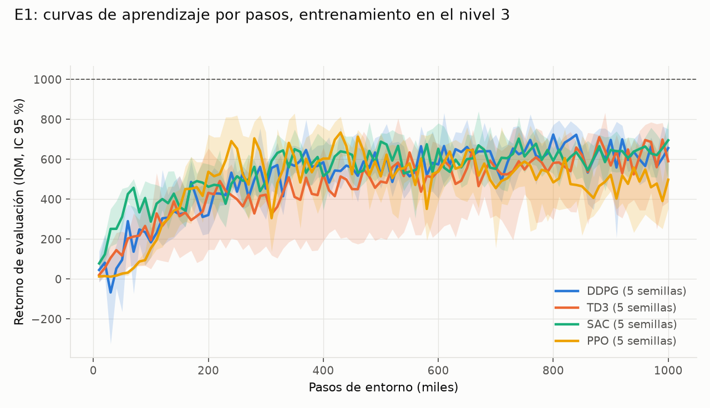
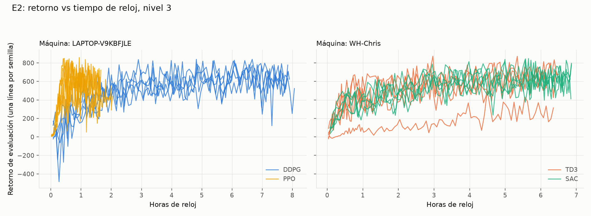
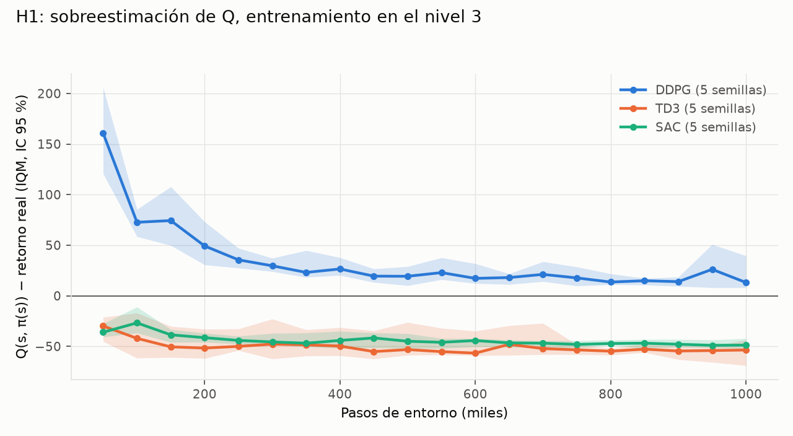

# Corridas finales: entrenamiento en el nivel 3

Generado con `python -m analysis.finales`. Retorno final de una corrida = media de sus últimas 3 evaluaciones. IQM (`rliable.metrics`) y media con IC 95 % por bootstrap percentil sobre corridas (2000 remuestreos, §7.5).

## Corridas

| Algoritmo | Semillas | Máquinas | Pasos por corrida | Pasos/s (mediana) | Commit |
|---|---|---|---|---|---|
| DDPG | 5: [0, 1, 2, 3, 4] | LAPTOP-V9KBFJLE [0, 1, 2, 3, 4] | 1000000 | 35 | 9576d09 |
| TD3 | 5: [0, 1, 2, 3, 4] | WH-Chris [0, 1, 2, 3, 4] | 1000000 | 44 | 9576d09 |
| SAC | 5: [0, 1, 2, 3, 4] | WH-Chris [0, 1, 2, 3, 4] | 1000000 | 41 | 9576d09 |
| PPO | 5: [0, 1, 2, 3, 4] | LAPTOP-V9KBFJLE [0, 1, 2, 3, 4] | 1000000 | 170 | 9576d09 |

## Desempeño final y eficiencia de muestras (E1, §7.4)

| Algoritmo | IQM del retorno final | Media del retorno final | Peor / mejor semilla | Pasos hasta el 90 % del final (mediana) |
|---|---|---|---|---|
| DDPG | 628.7 [485.2, 670.1] | 596.2 [507.4, 659.0] | 420.3 / 674.5 | 210k |
| TD3 | 632.3 [348.0, 703.2] | 569.6 [394.5, 686.7] | 223.9 / 727.4 | 340k |
| SAC | 665.5 [577.5, 693.0] | 647.0 [591.2, 684.0] | 538.3 / 700.1 | 170k |
| PPO | 453.1 [328.0, 599.4] | 455.2 [360.5, 550.0] | 288.1 / 628.6 | 160k |

## Diagnósticos (§8)

Valores al final del entrenamiento (media de los últimos 3 diagnósticos de cada corrida), IQM entre semillas con IC 95 %.

| Algoritmo | Sobreestimación de Q | ‖aₜ − aₜ₋₁‖ medio | Energía > corte (fracción) |
|---|---|---|---|
| DDPG | 17.6 [9.9, 35.1] | 0.181 [0.141, 0.220] | 0.622 [0.499, 0.692] |
| TD3 | -53.8 [-65.9, -47.9] | 0.179 [0.135, 0.218] | 0.721 [0.601, 0.775] |
| SAC | -48.5 [-51.4, -43.0] | 0.064 [0.062, 0.073] | 0.307 [0.244, 0.409] |
| PPO | – | 0.155 [0.109, 0.239] | 0.561 [0.388, 0.757] |

## E1: curvas por pasos

## E2: curvas por tiempo de reloj

El tiempo de reloj depende del hardware: solo se comparan algoritmos dentro de un mismo panel (máquina).

## H1: sobreestimación de Q

## Todas las corridas

| Algoritmo | Semilla | Máquina | Retorno final | Mejor eval. | Pasos al 90 % | Horas |
|---|---|---|---|---|---|---|
| DDPG | 0 | LAPTOP-V9KBFJLE | 420.3 | 839.2 | 60k | 8.1 |
| DDPG | 1 | LAPTOP-V9KBFJLE | 610.0 | 813.0 | 280k | 7.9 |
| DDPG | 2 | LAPTOP-V9KBFJLE | 661.1 | 821.4 | 290k | 7.9 |
| DDPG | 3 | LAPTOP-V9KBFJLE | 615.0 | 777.1 | 210k | 7.8 |
| DDPG | 4 | LAPTOP-V9KBFJLE | 674.5 | 835.9 | 170k | 7.7 |
| TD3 | 0 | WH-Chris | 727.4 | 873.3 | 200k | 6.5 |
| TD3 | 1 | WH-Chris | 645.6 | 814.2 | 340k | 6.2 |
| TD3 | 2 | WH-Chris | 596.2 | 799.9 | 180k | 6.5 |
| TD3 | 3 | WH-Chris | 223.9 | 501.1 | 640k | 6.4 |
| TD3 | 4 | WH-Chris | 655.0 | 871.3 | 480k | 6.1 |
| SAC | 0 | WH-Chris | 661.9 | 813.4 | 170k | 6.8 |
| SAC | 1 | WH-Chris | 679.0 | 834.9 | 160k | 6.9 |
| SAC | 2 | WH-Chris | 538.3 | 837.6 | 240k | 6.8 |
| SAC | 3 | WH-Chris | 700.1 | 828.1 | 310k | 6.8 |
| SAC | 4 | WH-Chris | 655.7 | 847.7 | 130k | 6.9 |
| PPO | 0 | LAPTOP-V9KBFJLE | 540.9 | 849.1 | 160k | 1.7 |
| PPO | 1 | LAPTOP-V9KBFJLE | 628.6 | 836.8 | 250k | 1.6 |
| PPO | 2 | LAPTOP-V9KBFJLE | 288.1 | 845.7 | 120k | 1.6 |
| PPO | 3 | LAPTOP-V9KBFJLE | 410.9 | 857.6 | 150k | 1.6 |
| PPO | 4 | LAPTOP-V9KBFJLE | 407.6 | 748.6 | 170k | 2.1 |
